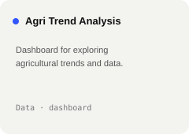
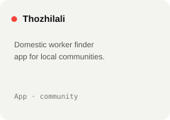

 

 

 

<!-- ## What I'm coding

 -->

 

<a href="https://itzraj.vercel.app">itzraj.vercel.app</a>
&nbsp;&nbsp;·&nbsp;&nbsp;
<a href="mailto:rajakumarcsecs@gmail.com">email</a>
&nbsp;&nbsp;·&nbsp;&nbsp;
<a href="https://www.linkedin.com/in/raja-kumar-s-a52334258/">linkedin</a>
&nbsp;&nbsp;·&nbsp;&nbsp;
<a href="https://leetcode.com/u/Rajakumar777/">leetcode</a>
&nbsp;&nbsp;·&nbsp;&nbsp;
<a href="https://www.instagram.com/vibeofray/">instagram</a>

